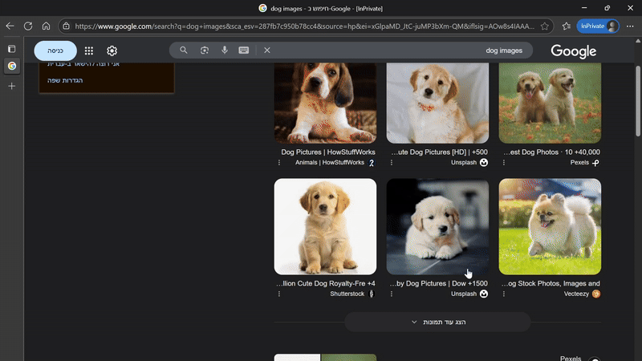

# MCP Windows Screenshots

[](https://www.npmjs.com/package/mcp-windows-screenshots)
[](https://opensource.org/licenses/MIT)

An MCP (Model Context Protocol) server that enables Claude to access Windows screenshots from WSL2. Perfect for seamlessly sharing screenshots with Claude Code without manual file navigation.

<a href="https://glama.ai/mcp/servers/@rubinsh/mcp-windows-screenshots">
  
</a>

<p align="center">
  
</p>

## Why This Tool?

When using Claude Code cli in WSL2 or in Cursor/VSCode, sharing Windows screenshots requires navigating complex file paths like `/mnt/c/Users/...` or dragging the image to the terminal.
Also, what if want to share the last 4 screenshots with Claude? this can become very cubersome. 
This tool simplifies the process to just:
1. Take a screenshot on Windows (Win+Shift+S)
2. Ask Claude to show your latest screenshot/s
3. Claude instantly accesses and displays it

No more copy-pasting paths or navigating directories!

### Key Features
- **Auto-detection**: Automatically detects your Windows Screenshots folder location from the registry
- **Cross-platform**: Works in both WSL2 and native Windows environments
- **Smart defaults**: Falls back to common screenshot locations if custom paths aren't found
- **Zero configuration**: Works out of the box for most users

## Prerequisites

- Windows 10/11 (with or without WSL2)
- Node.js 18+
- Claude Code CLI installed

## Installation

Run this single command in your terminal (works in WSL2, Windows Terminal, PowerShell, or Command Prompt):

```bash
claude mcp add windows-screenshots -s user -- npx mcp-windows-screenshots@latest
```

That's it! Restart Claude Code and you're ready to go.

The tool will automatically:
- Detect your environment (WSL2 or Windows)
- Find your Windows Screenshots folder from the registry
- Configure the appropriate paths

## Usage

Once installed, Claude can use these tools:

### View a Screenshot
Ask Claude: "Look at the latest screenshot"

Claude will automatically find it and look at the image.

### List Recent Screenshots
Ask Claude: "Show me my latest screenshots"

Claude will display your recent screenshots with timestamps and sizes.

### Check Screenshot Directories
Ask Claude: "Which directories are you checking for screenshots?"

Claude will show all configured paths.

## How It Works

The tool automatically:
1. **Detects your environment** (WSL2 vs native Windows)
2. **Queries Windows registry** for your actual Screenshots folder location
3. **Searches common locations** as fallback:
   - Your configured Screenshots folder (from Windows settings)
   - Pictures/Screenshots
   - OneDrive Pictures/Screenshots
   - Desktop
   - Documents/Screenshots
   - Temp folders

## Troubleshooting

### No screenshots found
1. Ask Claude to "list screenshot directories" to see which paths are being searched
2. Ensure your screenshots are saved in one of the searched directories
3. If your screenshots are in a custom location, see Advanced Configuration below

### Tool not available
1. Restart Claude Code after installation
2. Run `claude mcp list` to verify the server is installed
3. Ensure you used `-s user` when adding the server

## Advanced Configuration

### Custom Screenshot Directories
If your screenshots are saved in a non-standard location, you can specify custom directories:

#### WSL2 with custom paths:
```bash
claude mcp add windows-screenshots -s user \
  -e "MCP_SCREENSHOT_DIRS=/mnt/c/Users/john/CustomFolder;/mnt/c/Users/john/Desktop" \
  -- npx mcp-windows-screenshots@latest
```

#### Windows with custom paths:
```bash
claude mcp add windows-screenshots -s user -e "MCP_SCREENSHOT_DIRS=C:\Users\john\CustomFolder;C:\Users\john\Desktop" -- npx mcp-windows-screenshots@latest
```

### Environment Variables
- `WINDOWS_USERNAME`: Override the auto-detected Windows username
- `MCP_SCREENSHOT_DIRS`: Specify custom screenshot directories (semicolon-separated for multiple paths)

### Manual Username Configuration
If the auto-detection doesn't find the correct username:

#### WSL2:
```bash
claude mcp add windows-screenshots -s user \
  -e "WINDOWS_USERNAME=YourWindowsUsername" \
  -- npx mcp-windows-screenshots@latest
```

#### Windows:
```bash
claude mcp add windows-screenshots -s user -e "WINDOWS_USERNAME=YourWindowsUsername" -- npx mcp-windows-screenshots@latest
```

## Development

To contribute or modify this tool:

```bash
git clone https://github.com/rubinsh/mcp-windows-screenshots.git
cd mcp-windows-screenshots
npm install
npm run build
```

## License

MIT © [rubinsh](https://github.com/rubinsh)